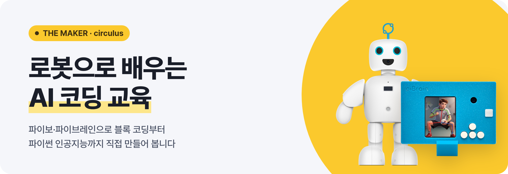
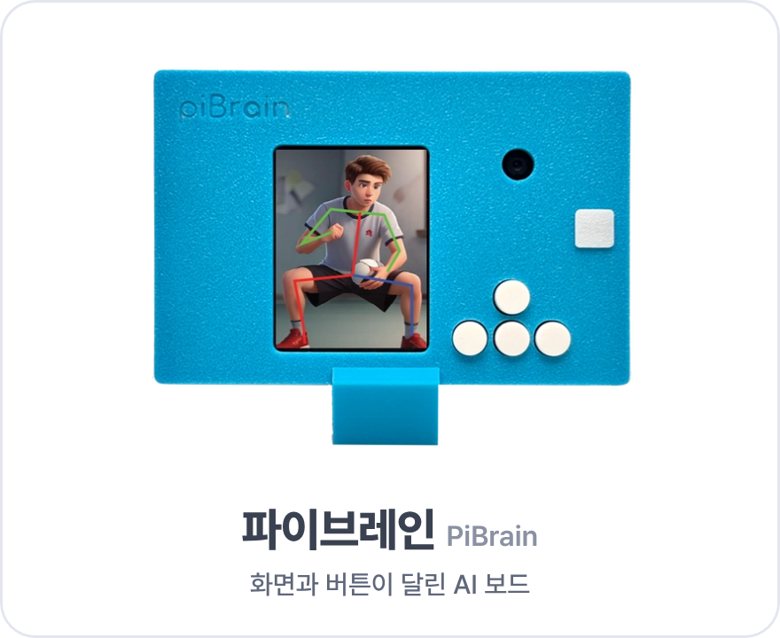
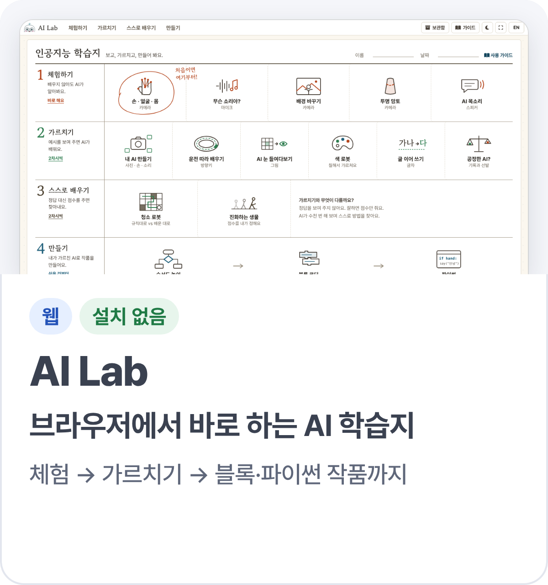
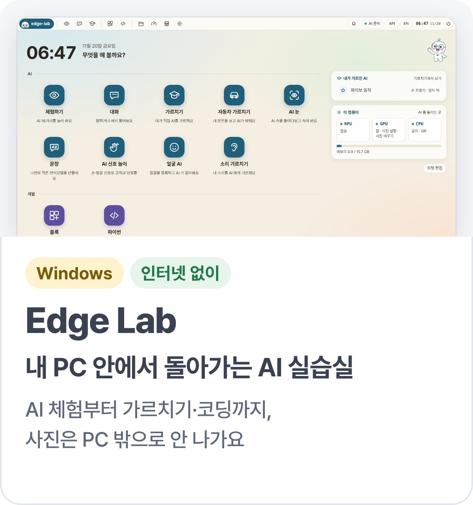
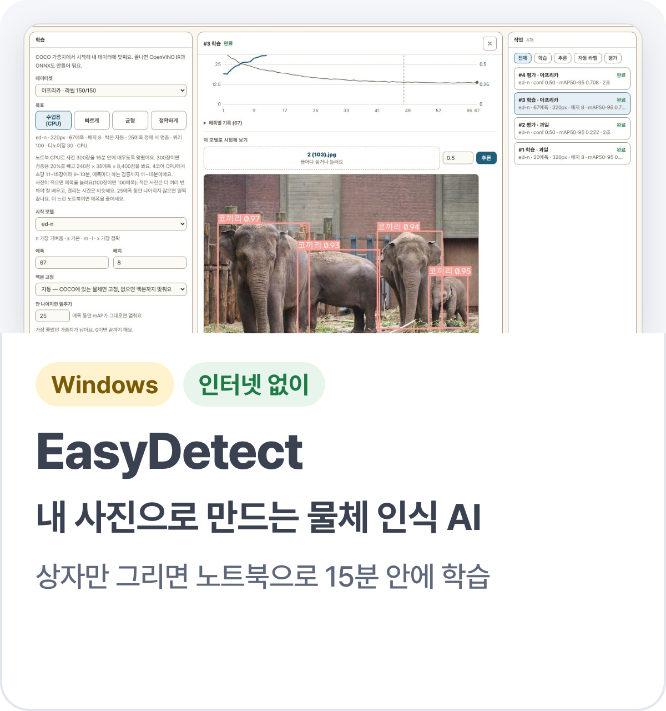
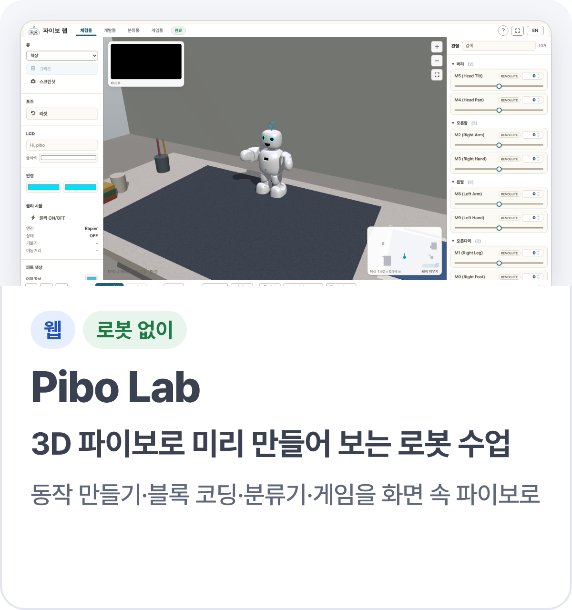
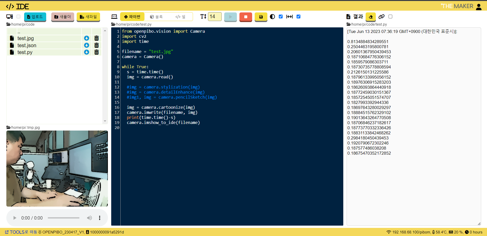
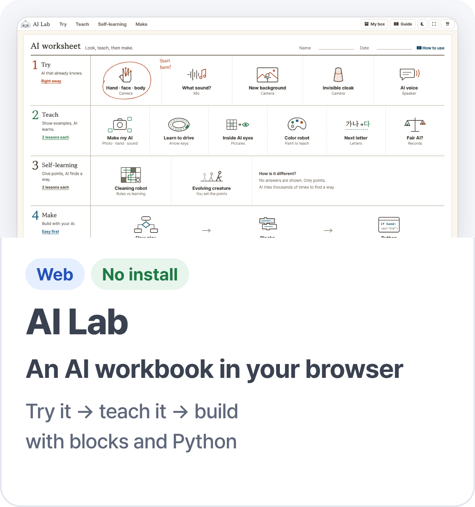
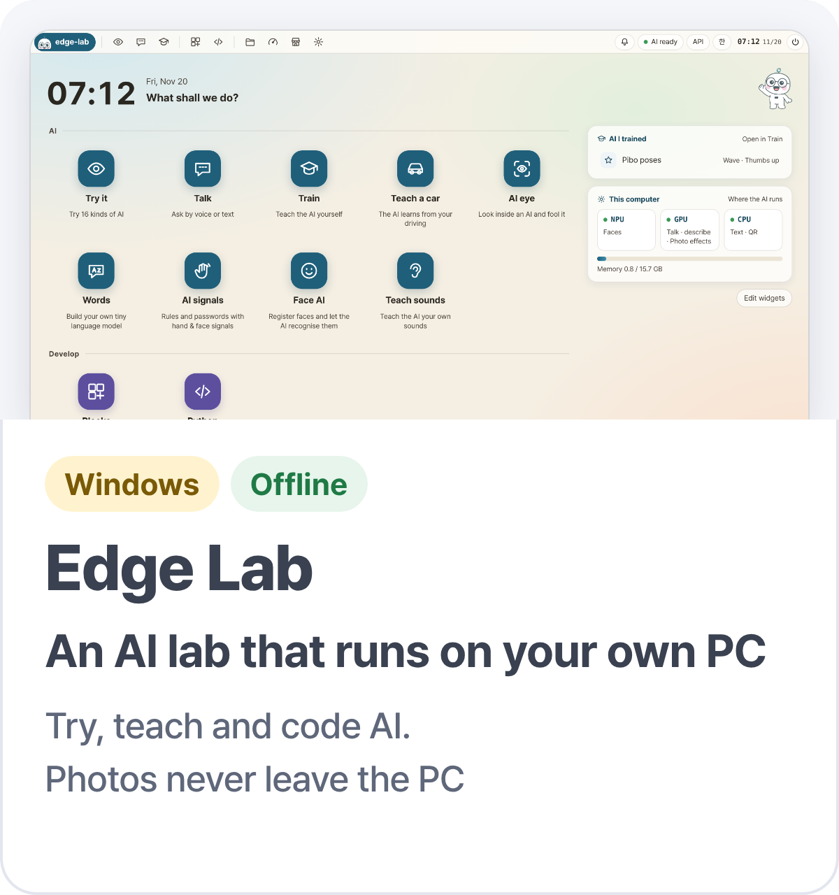
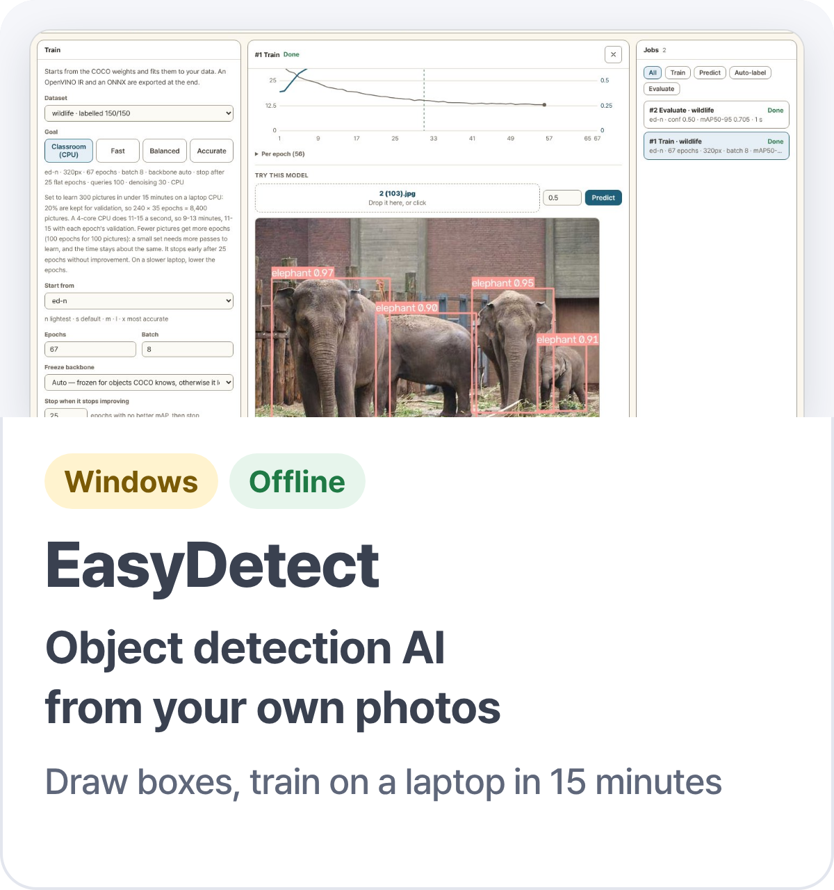

  
  
  
  

<b>한국어</b> · <a href="#english">English</a>

  서큘러스의 교육 브랜드 <b>THE MAKER</b>입니다. 인공지능 로봇 파이보·파이브레인과 AI 교육 소프트웨어로 
  블록 코딩부터 파이썬 인공지능까지, 직접 만지고 가르치고 코딩하며 배웁니다.

 

  
  

## AI 교육 소프트웨어

로봇이 없어도, 인터넷이 없어도 AI를 배웁니다. 찍은 사진과 소리는 기기 밖으로 나가지 않습니다.

<table>
  <tr>
    <td width="33%" valign="top" align="center">
       
      <a href="https://themakerrobot.github.io/ai-lab/"><b>바로 쓰기</b></a> · <a href="https://themakerrobot.github.io/ai-lab/guide/">가이드</a>
    </td>
    <td width="33%" valign="top" align="center">
       
      <a href="https://github.com/themakerrobot/edge-lab/releases/latest"><b>다운로드</b></a> · <a href="https://github.com/themakerrobot/edge-lab/releases">릴리스 노트</a> · <a href="https://github.com/themakerrobot/edge-lab/blob/main/docs/MANUAL.md">가이드</a>
    </td>
    <td width="33%" valign="top" align="center">
       
      <a href="https://github.com/themakerrobot/easydetect-lab/releases/latest"><b>다운로드</b></a> · <a href="https://github.com/themakerrobot/easydetect-lab/releases">릴리스 노트</a> · <a href="https://themakerrobot.github.io/easydetect-lab/">가이드</a> · <a href="https://themakerrobot.github.io/easydetect/try.html">웹 체험</a>
    </td>
  </tr>
</table>

## 파이보·파이브레인과 함께 쓰는 소프트웨어

<table>
  <tr>
    <td width="50%" valign="top" align="center">
       
      <a href="https://pibo-lab.themaker.workers.dev/"><b>바로 쓰기</b></a>
    </td>
    <td width="50%" valign="top" align="center">
       
      <a href="https://github.com/themakerrobot/pibo-connect/releases/latest"><b>다운로드</b></a> · <a href="https://github.com/themakerrobot/pibo-connect/releases">릴리스 노트</a> · <a href="https://github.com/themakerrobot/pibo-connect#readme">가이드</a>
    </td>
  </tr>
</table>

## 파이보·파이브레인 시작하기

### 내 기기에 맞는 문서와 예제

파이보·파이브레인은 **운영체제(OS) 버전마다 쓸 수 있는 기능과 블록이 다릅니다.**
기기와 같은 버전의 문서와 예제를 보세요.

1. 기기의 OS 버전을 확인합니다. 버전은 `260624v1`처럼 적혀 있습니다.
2. **[버전별 문서·예제](https://themakerrobot.github.io/openpibo-guide/)** 에서 기기와 같은 버전을 엽니다.
3. 기기 안의 **piBo Maker · piBrain Maker**에서 블록이나 파이썬으로 실행합니다.

OS 설치 이미지와 사용 가이드는 [공유 폴더](https://circulusworkspace-my.sharepoint.com/:f:/g/personal/leeyunjai_circul_us1/IgBLHRASCkOiSaZUlrbGnfglAbEknmT2sq_XVxMRmbLLUrM?e=o2QL8Z)에 있습니다. 지원 하드웨어: Raspberry Pi 4B

### piBo Maker · piBrain Maker — 기기 안의 개발 환경

파이보에는 **piBo Maker**, 파이브레인에는 **piBrain Maker**가 들어 있습니다. 같은 와이파이에 연결한 PC 브라우저로 접속해서 씁니다.

- **Tools** — 모터, 센서, 카메라, 마이크를 하나씩 켜 보고 값을 확인하며 로봇의 작동 원리를 익힙니다.
- **IDE** — 블록 코딩과 파이썬을 지원합니다. 이미지·오디오 재생, 파일 탐색기, 로그 보기가 함께 있습니다.

    
    

  <a href="https://docs.google.com/forms/d/e/1FAIpQLSdU2oCmdhZ0bHcyK7MYdUHiultM6w9UE3cIt_KLppp-9Ug-ag/viewform">도입 문의</a> · 교육 문의 <a href="mailto:info@circul.us">info@circul.us</a> · <a href="http://pibo.circul.us">pibo.circul.us</a>

---

## English

**THE MAKER** is the education brand of Circulus. With the AI robots **Pibo** and **piBrain** and our AI education
software, students go from block coding to AI in Python — touching, teaching and coding it themselves.

- **Pibo** — a humanoid AI robot that moves
- **piBrain** — an AI board with a screen and buttons

### AI education software

Learn AI without a robot, even without the internet. Photos and sounds never leave the device.

<table>
  <tr>
    <td width="33%" valign="top" align="center">
       
      <a href="https://themakerrobot.github.io/ai-lab/"><b>Open</b></a> · <a href="https://themakerrobot.github.io/ai-lab/guide/">Guide</a>
    </td>
    <td width="33%" valign="top" align="center">
       
      <a href="https://github.com/themakerrobot/edge-lab/releases/latest"><b>Download</b></a> · <a href="https://github.com/themakerrobot/edge-lab/releases">Release notes</a> · <a href="https://github.com/themakerrobot/edge-lab/blob/main/docs/MANUAL.md#edge-lab-user-guide">Guide</a>
    </td>
    <td width="33%" valign="top" align="center">
       
      <a href="https://github.com/themakerrobot/easydetect-lab/releases/latest"><b>Download</b></a> · <a href="https://github.com/themakerrobot/easydetect-lab/releases">Release notes</a> · <a href="https://themakerrobot.github.io/easydetect-lab/">Guide</a> · <a href="https://themakerrobot.github.io/easydetect/try.html">Try on the web</a>
    </td>
  </tr>
</table>

### Software for Pibo and piBrain

<table>
  <tr>
    <td width="50%" valign="top" align="center">
       
      <a href="https://pibo-lab.themaker.workers.dev/"><b>Open</b></a>
    </td>
    <td width="50%" valign="top" align="center">
       
      <a href="https://github.com/themakerrobot/pibo-connect/releases/latest"><b>Download</b></a> · <a href="https://github.com/themakerrobot/pibo-connect/releases">Release notes</a> · <a href="https://github.com/themakerrobot/pibo-connect#readme">Guide</a>
    </td>
  </tr>
</table>

### Getting started with Pibo and piBrain

#### Docs and examples for your device

Features and blocks **differ by OS version**, so use the docs for the version on your device.

1. Check your device's OS version. It looks like `260624v1`.
2. Open the same version in **[Docs and examples by version](https://themakerrobot.github.io/openpibo-guide/)**.
3. Run blocks or Python in **piBo Maker** or **piBrain Maker** on the device.

OS images and setup guides are in the [shared folder](https://circulusworkspace-my.sharepoint.com/:f:/g/personal/leeyunjai_circul_us1/IgBLHRASCkOiSaZUlrbGnfglAbEknmT2sq_XVxMRmbLLUrM?e=o2QL8Z). Supported hardware: Raspberry Pi 4B

#### piBo Maker · piBrain Maker — on the device

Pibo comes with **piBo Maker** and piBrain with **piBrain Maker**. Open it from a PC browser on the same Wi-Fi.

- **Tools** — turn on motors, sensors, the camera and the microphone one by one and see how the robot works.
- **IDE** — block coding and Python, with image and audio playback, a file explorer and logs.

  <a href="https://docs.google.com/forms/d/e/1FAIpQLSdU2oCmdhZ0bHcyK7MYdUHiultM6w9UE3cIt_KLppp-9Ug-ag/viewform">Request a demo</a> · Contact <a href="mailto:info@circul.us">info@circul.us</a> · <a href="http://pibo.circul.us">pibo.circul.us</a>

