

  
  
  
  

<b>한국어</b> · <a href="#english">English</a>

<h3 align="center">만지고, 가르치고, 코딩하며 배우는 AI</h3>

  서큘러스의 교육 브랜드 <b>THE MAKER</b>는 AI 로봇 <b>파이보·파이브레인</b>과 <b>AI 교육 소프트웨어</b>로 
  체험에서 시작해 블록 코딩과 파이썬을 거쳐, 직접 만든 AI가 로봇을 움직이기까지 한 흐름으로 가르칩니다.

## 왜 THE MAKER인가요

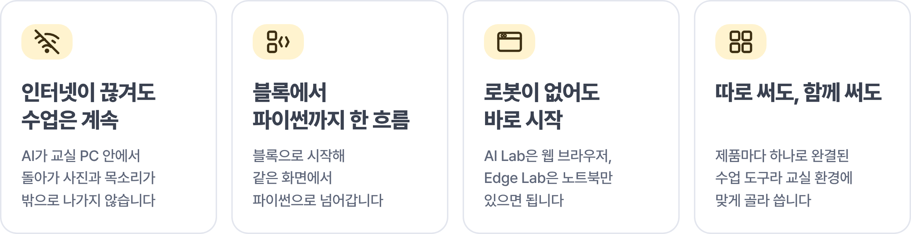

## 교실 준비물에 맞춰 고르세요

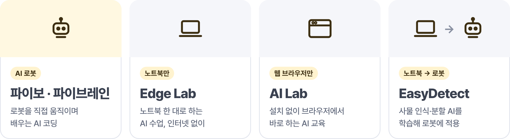

## 이렇게 배웁니다

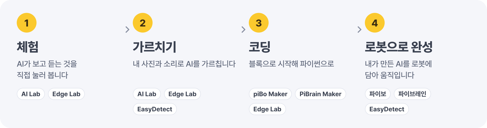

## 파이보 · 파이브레인 — 로봇으로 배우는 AI

움직이는 휴머노이드 **파이보**, 화면과 버튼이 달린 AI 보드 **파이브레인**. 수업에서 만든 AI를 로봇에 실어 직접 움직여 봅니다.

  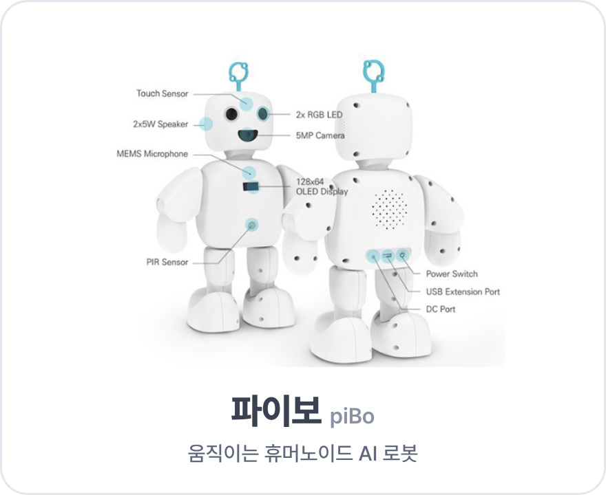
  

### piBo Maker · piBrain Maker — 로봇 안에 들어 있는 개발 환경

파이보에는 **piBo Maker**, 파이브레인에는 **piBrain Maker**가 들어 있습니다. 같은 와이파이에 연결한 PC 브라우저로 접속해서 씁니다.

- **Tools** — 모터, 센서, 카메라, 마이크를 하나씩 켜 보고 값을 확인하며 로봇의 작동 원리를 익힙니다.
- **IDE** — 블록 코딩과 파이썬을 지원합니다. 이미지·오디오 재생, 파일 탐색기, 로그 보기가 함께 있습니다.

  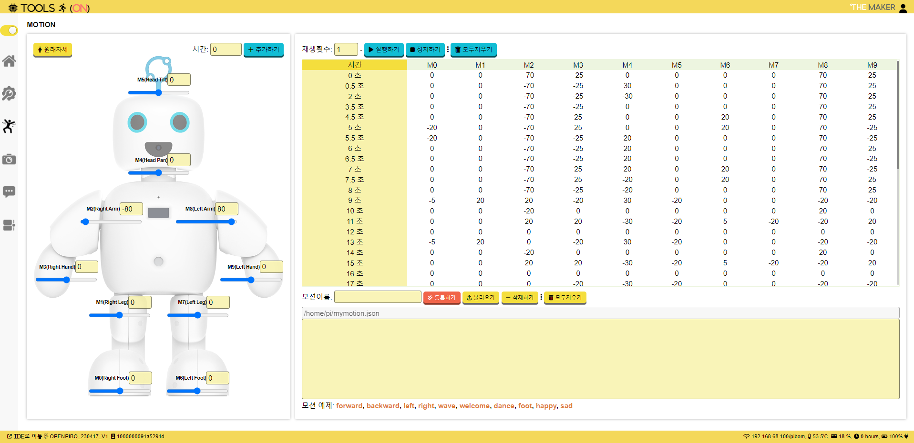  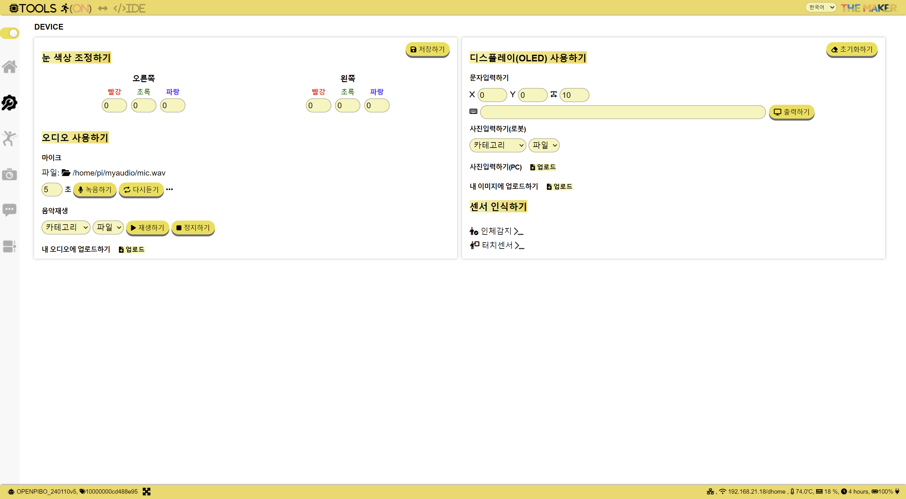
    

### 로봇 수업을 돕는 소프트웨어

수업 준비는 화면 속 파이보로, 수업 당일에는 교실의 로봇을 한 화면에서.

<table>
  <tr>
    <td width="50%" valign="top" align="center">
       
      <a href="https://pibo-lab.themaker.workers.dev/"><b>바로 쓰기</b></a>
    </td>
    <td width="50%" valign="top" align="center">
      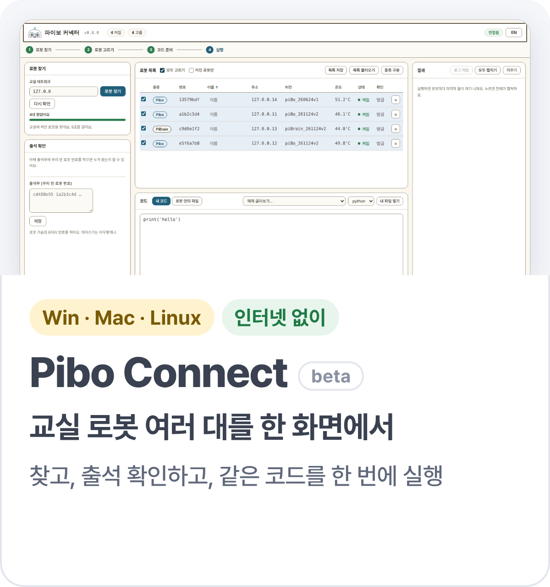 
      <a href="https://github.com/themakerrobot/pibo-connect/releases/latest"><b>다운로드</b></a> · <a href="https://github.com/themakerrobot/pibo-connect/releases">릴리스 노트</a> · <a href="https://github.com/themakerrobot/pibo-connect#readme">가이드</a>
    </td>
  </tr>
</table>

## Edge Lab — 노트북 한 대로 하는 AI 수업

<table>
  <tr>
    <td width="56%" valign="middle">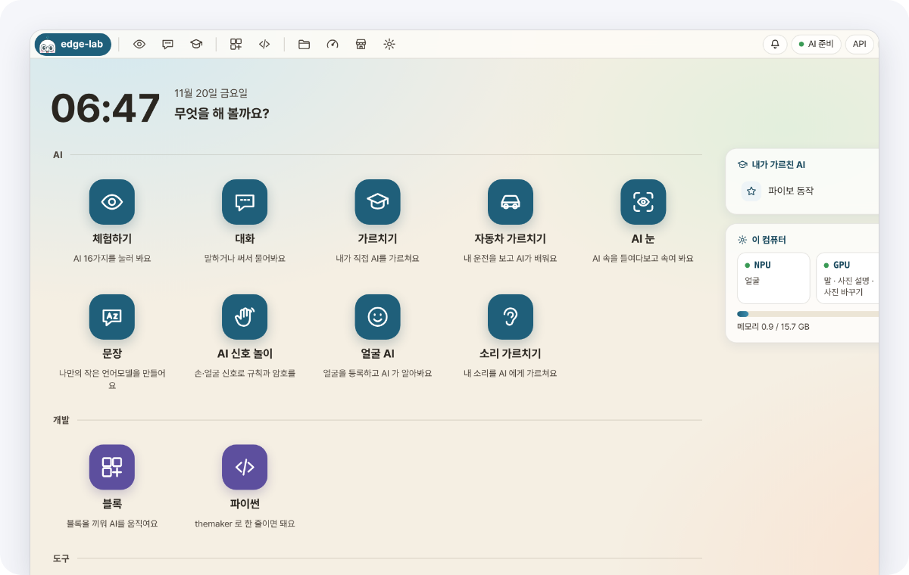</td>
    <td width="44%" valign="middle">
      
설치하고 나면 <b>인터넷 없이</b> 교실 노트북 안에서 모든 AI가 돌아갑니다.

      <ul>
        <li><b>체험하기</b> — 얼굴·자세·손·사물·글자 등 AI 16가지</li>
        <li><b>가르치기</b> — 내 사진과 소리로 직접 AI를 가르치기</li>
        <li><b>코딩</b> — 블록과 파이썬으로 AI 부르기</li>
        <li>Intel AI PC의 CPU·GPU·NPU로 실행, 계정·요금 없음</li>
      </ul>
      
<a href="https://github.com/themakerrobot/edge-lab/releases/latest"><b>다운로드</b></a> · <a href="https://github.com/themakerrobot/edge-lab/releases">릴리스 노트</a> · <a href="https://github.com/themakerrobot/edge-lab/blob/main/docs/MANUAL.md">가이드</a>

    </td>
  </tr>
</table>

## AI Lab — 웹 브라우저만으로 하는 AI 교육

<table>
  <tr>
    <td width="56%" valign="middle">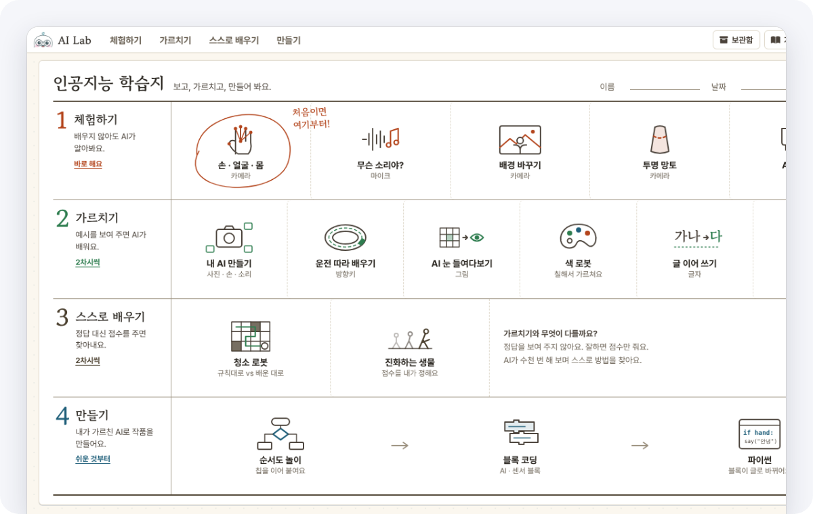</td>
    <td width="44%" valign="middle">
      
<b>설치 없이</b> 링크만 열면 시작합니다. 사진과 소리는 기기 밖으로 나가지 않습니다.

      <ul>
        <li><b>체험하기</b> — 손·얼굴·몸 인식, 소리 구분, 배경 바꾸기</li>
        <li><b>가르치기</b> — 예시를 보여 주며 내 AI 만들기</li>
        <li><b>스스로 배우기</b> — 점수로 배우는 청소 로봇·진화하는 생물</li>
        <li><b>만들기</b> — 순서도 → 블록 → 파이썬으로 작품 완성</li>
      </ul>
      
<a href="https://themakerrobot.github.io/ai-lab/"><b>바로 쓰기</b></a> · <a href="https://themakerrobot.github.io/ai-lab/guide/">가이드</a>

    </td>
  </tr>
</table>

## EasyDetect — 내 사진으로 만든 AI를 로봇에

<table>
  <tr>
    <td width="56%" valign="middle">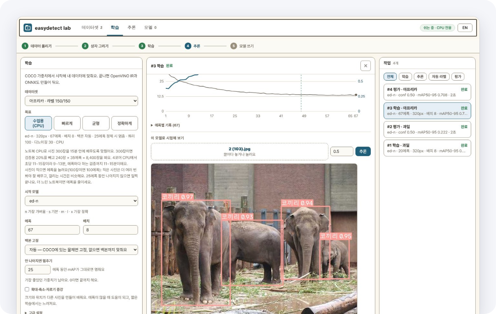</td>
    <td width="44%" valign="middle">
      
노트북에서 <b>학습하고 시험한 뒤</b>, 파일 하나로 <b>파이보·파이브레인</b>에 옮겨 실행합니다.

      <ul>
        <li><b>3가지 AI</b> — 사물 인식(상자) · 윤곽 분할 · 자세(키포인트)</li>
        <li><b>학습</b> — 노트북 CPU로 사진 100~300장을 10~15분 안에</li>
        <li><b>추론</b> — 사진·영상·웹캠으로 바로 시험</li>
        <li><b>로봇에 적용</b> — ONNX 파일 하나로 파이보·파이브레인에서 실행</li>
      </ul>
      
<a href="https://github.com/themakerrobot/easydetect-lab/releases/latest"><b>다운로드</b></a> · <a href="https://github.com/themakerrobot/easydetect-lab/releases">릴리스 노트</a> · <a href="https://themakerrobot.github.io/easydetect-lab/">가이드</a> · <a href="https://themakerrobot.github.io/easydetect/try.html">웹 체험</a>

    </td>
  </tr>
</table>

 

  
  

## 파이보·파이브레인 시작하기

파이보·파이브레인은 **운영체제(OS) 버전마다 쓸 수 있는 기능과 블록이 다릅니다.** 기기와 같은 버전의 문서와 예제를 보세요.

1. 기기의 OS 버전을 확인합니다. 버전은 `260624v1`처럼 적혀 있습니다.
2. **[버전별 문서·예제](https://themakerrobot.github.io/openpibo-guide/)** 에서 기기와 같은 버전을 엽니다.
3. 기기 안의 **piBo Maker · piBrain Maker**에서 블록이나 파이썬으로 실행합니다.

OS 설치 이미지와 사용 가이드는 [공유 폴더](https://circulusworkspace-my.sharepoint.com/:f:/g/personal/leeyunjai_circul_us1/IgBLHRASCkOiSaZUlrbGnfglAbEknmT2sq_XVxMRmbLLUrM?e=o2QL8Z)에 있습니다. 지원 하드웨어: Raspberry Pi 4B

  <a href="https://docs.google.com/forms/d/e/1FAIpQLSdU2oCmdhZ0bHcyK7MYdUHiultM6w9UE3cIt_KLppp-9Ug-ag/viewform">도입 문의</a> · 교육 문의 <a href="mailto:info@circul.us">info@circul.us</a> · <a href="http://pibo.circul.us">pibo.circul.us</a>

---

## English

<h3 align="center">Learn AI by touching, teaching and coding it</h3>

  <b>THE MAKER</b>, the education brand of Circulus, teaches AI in one path with the AI robots <b>piBo</b> and <b>piBrain</b> 
  and our <b>AI education software</b> — from hands-on play, through blocks and Python, to your own AI moving a robot.

### Why THE MAKER

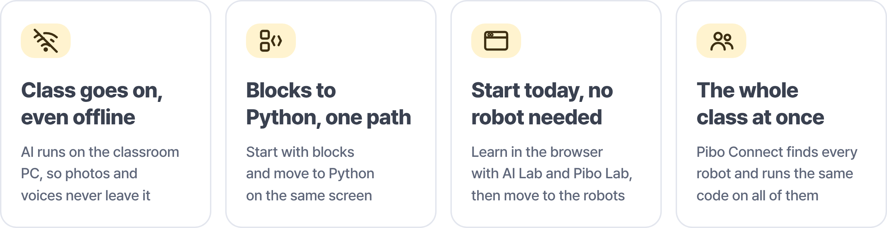

### Pick what fits your classroom

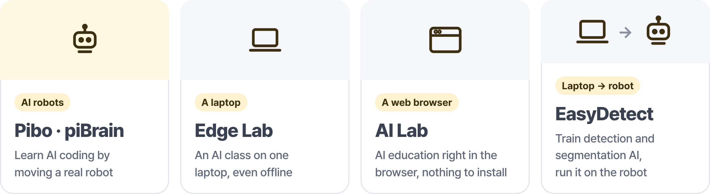

### How students learn

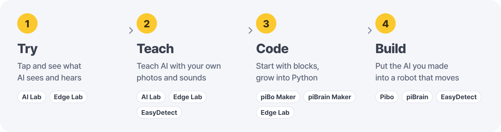

### piBo · piBrain — learn AI with robots

**piBo**, a humanoid robot that moves, and **piBrain**, an AI board with a screen and buttons. Students put the AI they made onto the robot and watch it move.

#### piBo Maker · piBrain Maker — built into the robot

piBo comes with **piBo Maker** and piBrain with **piBrain Maker**. Open it from a PC browser on the same Wi-Fi.

- **Tools** — turn on motors, sensors, the camera and the microphone one by one and see how the robot works.
- **IDE** — block coding and Python, with image and audio playback, a file explorer and logs.

    
    

#### Software for robot classes

Prepare lessons with an on-screen piBo, then run the whole classroom of robots from one screen.

<table>
  <tr>
    <td width="50%" valign="top" align="center">
      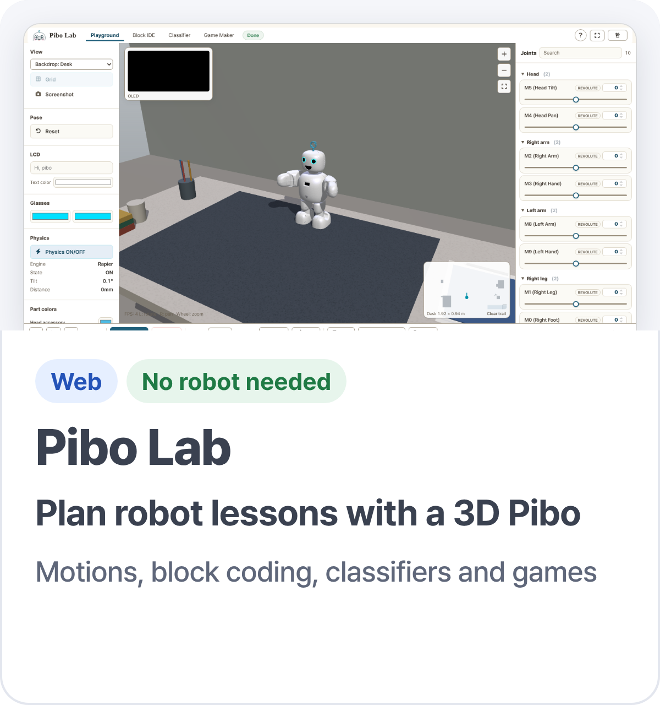 
      <a href="https://pibo-lab.themaker.workers.dev/"><b>Open</b></a>
    </td>
    <td width="50%" valign="top" align="center">
      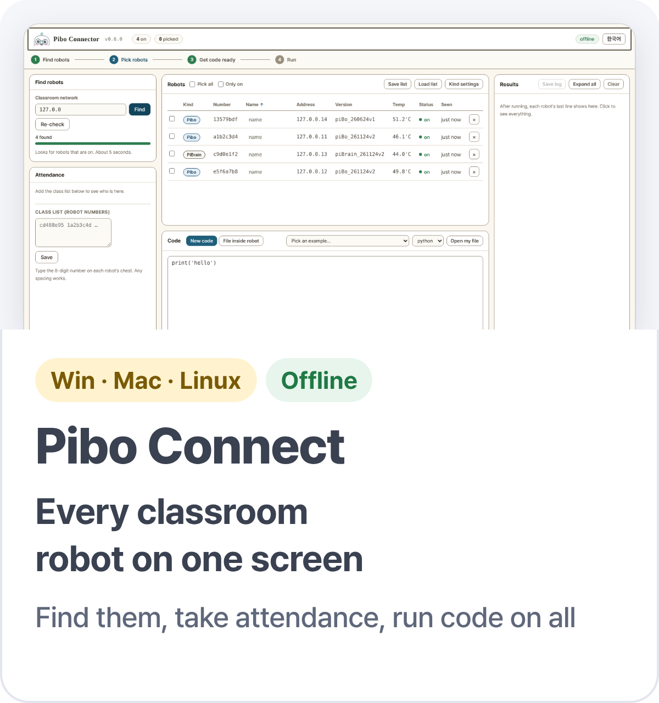 
      <a href="https://github.com/themakerrobot/pibo-connect/releases/latest"><b>Download</b></a> · <a href="https://github.com/themakerrobot/pibo-connect/releases">Release notes</a> · <a href="https://github.com/themakerrobot/pibo-connect#readme">Guide</a>
    </td>
  </tr>
</table>

### Edge Lab — an AI class on one laptop

<table>
  <tr>
    <td width="56%" valign="middle">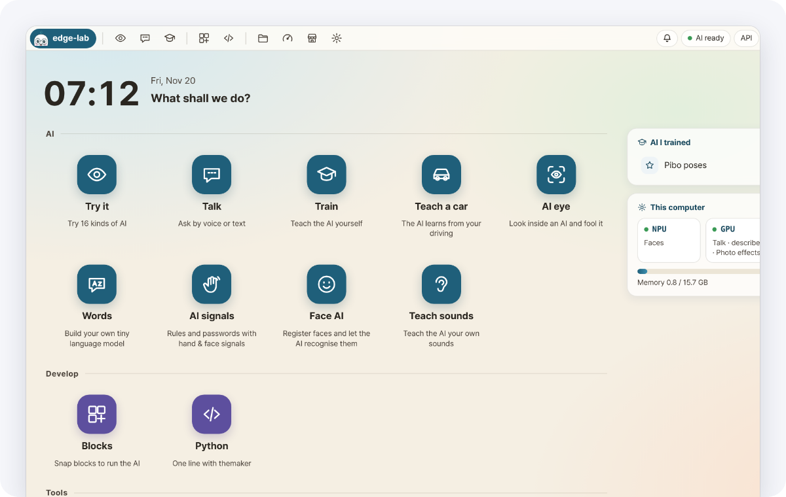</td>
    <td width="44%" valign="middle">
      
Once installed, every AI runs inside the classroom laptop — <b>no internet needed</b>.

      <ul>
        <li><b>Try</b> — 16 kinds of AI: faces, poses, hands, objects, text and more</li>
        <li><b>Teach</b> — teach the AI with your own photos and sounds</li>
        <li><b>Code</b> — call the AI from blocks and Python</li>
        <li>Runs on the CPU, GPU and NPU of an Intel AI PC. No account, no fees</li>
      </ul>
      
<a href="https://github.com/themakerrobot/edge-lab/releases/latest"><b>Download</b></a> · <a href="https://github.com/themakerrobot/edge-lab/releases">Release notes</a> · <a href="https://github.com/themakerrobot/edge-lab/blob/main/docs/MANUAL.md#edge-lab-user-guide">Guide</a>

    </td>
  </tr>
</table>

### AI Lab — AI education in a web browser

<table>
  <tr>
    <td width="56%" valign="middle">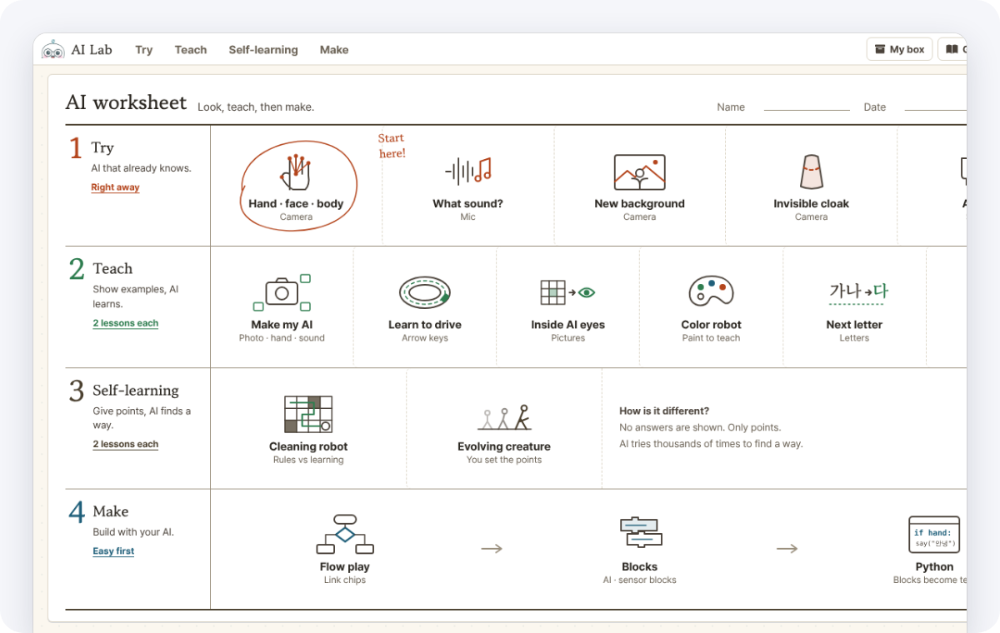</td>
    <td width="44%" valign="middle">
      
<b>Nothing to install</b> — open the link and start. Photos and sounds never leave the device.

      <ul>
        <li><b>Try</b> — hand, face and body tracking, sounds, background swap</li>
        <li><b>Teach</b> — build your own AI by showing it examples</li>
        <li><b>Learn by itself</b> — a cleaning robot and creatures that learn from scores</li>
        <li><b>Build</b> — flowcharts → blocks → Python</li>
      </ul>
      
<a href="https://themakerrobot.github.io/ai-lab/"><b>Open</b></a> · <a href="https://themakerrobot.github.io/ai-lab/guide/">Guide</a>

    </td>
  </tr>
</table>

### EasyDetect — your own AI, on the robot

<table>
  <tr>
    <td width="56%" valign="middle">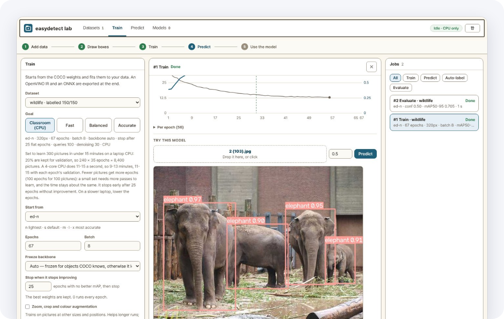</td>
    <td width="44%" valign="middle">
      
<b>Train and test</b> on a laptop, then move the model to <b>piBo or piBrain</b> as a single file.

      <ul>
        <li><b>Three kinds of AI</b> — object detection, segmentation, pose (keypoints)</li>
        <li><b>Train</b> — 100–300 photos in 10–15 minutes on a laptop CPU</li>
        <li><b>Run</b> — test on photos, videos or a webcam right away</li>
        <li><b>On the robot</b> — one ONNX file runs on piBo and piBrain</li>
      </ul>
      
<a href="https://github.com/themakerrobot/easydetect-lab/releases/latest"><b>Download</b></a> · <a href="https://github.com/themakerrobot/easydetect-lab/releases">Release notes</a> · <a href="https://themakerrobot.github.io/easydetect-lab/">Guide</a> · <a href="https://themakerrobot.github.io/easydetect/try.html">Try on the web</a>

    </td>
  </tr>
</table>

 

### Getting started with piBo and piBrain

Features and blocks **differ by OS version**, so use the docs for the version on your device.

1. Check your device's OS version. It looks like `260624v1`.
2. Open the same version in **[Docs and examples by version](https://themakerrobot.github.io/openpibo-guide/)**.
3. Run blocks or Python in **piBo Maker** or **piBrain Maker** on the device.

OS images and setup guides are in the [shared folder](https://circulusworkspace-my.sharepoint.com/:f:/g/personal/leeyunjai_circul_us1/IgBLHRASCkOiSaZUlrbGnfglAbEknmT2sq_XVxMRmbLLUrM?e=o2QL8Z). Supported hardware: Raspberry Pi 4B

  <a href="https://docs.google.com/forms/d/e/1FAIpQLSdU2oCmdhZ0bHcyK7MYdUHiultM6w9UE3cIt_KLppp-9Ug-ag/viewform">Request a demo</a> · Contact <a href="mailto:info@circul.us">info@circul.us</a> · <a href="http://pibo.circul.us">pibo.circul.us</a>

