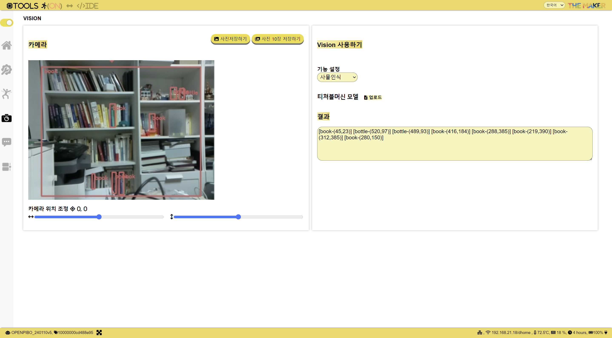
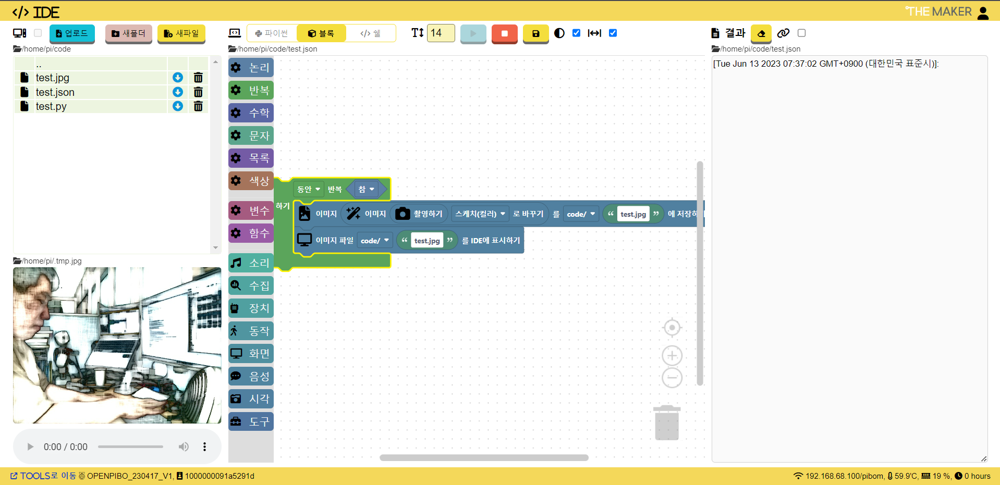
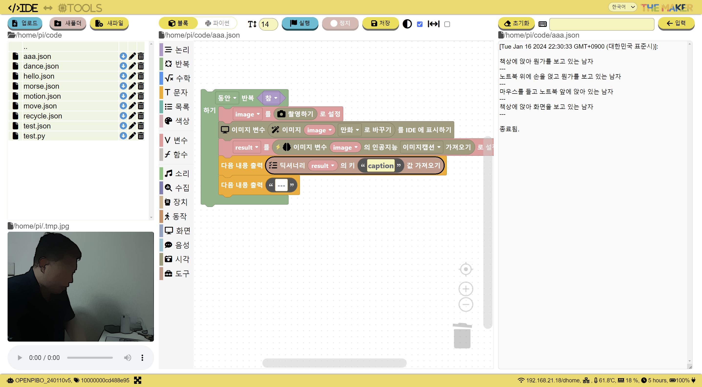

  
  
  
  

  서큘러스의 교육 브랜드 <b>THE MAKER</b>입니다. 인공지능 로봇 파이보와 파이브레인으로 
  블록 코딩부터 파이썬 인공지능까지, 직접 만지고 코딩하며 나만의 로봇 서비스를 만듭니다.

 

  
  

## 시작하기

1. 기기의 **운영체제(OS) 버전**을 확인합니다.
2. [문서·예제 사이트](https://themakerrobot.github.io/openpibo-guide/)에서 **같은 버전**의 문서와 예제를 엽니다.
3. 기기 안의 **Pibo Maker IDE**에서 블록이나 파이썬으로 실행합니다.

**운영체제** · 지원 하드웨어 Raspberry Pi 4B · [운영체제 이미지와 사용 가이드 (공유 폴더)](https://circulusworkspace-my.sharepoint.com/:f:/g/personal/leeyunjai_circul_us1/IgBLHRASCkOiSaZUlrbGnfglAbEknmT2sq_XVxMRmbLLUrM?e=o2QL8Z)

## Pibo Maker

기기 안에 들어 있는 개발 환경입니다. 같은 와이파이에 연결한 PC 브라우저로 접속해서 씁니다.

- **Tools** — 모터, 센서, 카메라, 마이크를 하나씩 켜 보고 값을 확인하며 로봇의 작동 원리를 익힙니다.
- **IDE** — 블록 코딩과 파이썬을 지원합니다. 이미지·오디오 재생, 파일 탐색기, 로그 보기가 함께 있습니다.

    
    

## 파이보·파이브레인과 함께 쓰는 소프트웨어

| 이름 | 하는 일 | 바로가기 |
|---|---|---|
| **Pibo Lab** | 기기 없이 온라인에서 파이보를 체험하고 활용합니다 | [바로 쓰기](https://pibo-lab.themaker.workers.dev/) |
| **Pibo Connect** | 교실의 파이보·파이브레인 여러 대를 한 화면에서 찾고, 같은 코드를 한 번에 실행합니다. 로봇에는 아무것도 설치하지 않습니다 | [자세히 보기](https://github.com/themakerrobot/pibo-connect) |

## AI 교육 소프트웨어

로봇 없이 브라우저나 PC만으로 AI를 배웁니다.

| 이름 | 하는 일 | 쓰는 곳 | 바로가기 |
|---|---|---|---|
| **AI Lab** | 보고, 가르치고, 블록과 파이썬으로 만들어 보는 AI 학습지 | 브라우저 (설치 없음) | [바로 쓰기](https://themakerrobot.github.io/ai-lab/) · [가이드](https://themakerrobot.github.io/ai-lab/guide/) |
| **Edge Lab** | 사진을 찍어 AI에게 묻고, 직접 가르치고, 블록과 파이썬으로 AI를 부릅니다 | 내 PC (인터넷 없이) | [자세히 보기](https://github.com/themakerrobot/edge-lab) |
| **EasyDetect** | 내 사진으로 물체 인식 모델을 만듭니다. 사진 올리기 → 상자 그리기 → 학습 → 시험 | 내 PC (인터넷 없이) | [가이드](https://themakerrobot.github.io/easydetect-lab/) |

---

  <a href="https://docs.google.com/forms/d/e/1FAIpQLSdU2oCmdhZ0bHcyK7MYdUHiultM6w9UE3cIt_KLppp-9Ug-ag/viewform">도입 문의</a> · 교육 문의 <a href="mailto:info@circul.us">info@circul.us</a> · <a href="http://pibo.circul.us">pibo.circul.us</a>

